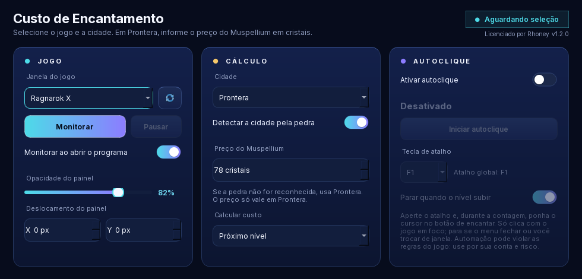

# ROX Enchantment Overlay


[](https://github.com/rhoneycruz-ui/rox-enchantment-overlay/releases/latest)
[](https://github.com/rhoneycruz-ui/rox-enchantment-overlay/releases/latest)
[](https://github.com/rhoneycruz-ui/rox-enchantment-overlay/actions/workflows/tests.yml)
[](LICENSE)

Assistente gratuito e local para calcular, em tempo real, quanto falta para subir o encantamento em Ragnarok X, em **qualquer uma das 8 cidades**. O programa reconhece arma, armadura ou acessório, lê o nível e a barra de progresso, descobre a cidade pela pedra do menu e mostra uma sobreposição compacta ao lado do menu do jogo: cristais em Prontera e pedras de encantamento nas demais cidades.

> O programa não modifica o jogo e não envia imagens ou dados pela internet. A leitura é feita visualmente na tela do próprio computador.

**[Baixar a versão portátil para Windows](https://github.com/rhoneycruz-ui/rox-enchantment-overlay/releases/latest/download/ROX-Enchantment-Overlay-portable.zip)** · [Notas da versão](https://github.com/rhoneycruz-ui/rox-enchantment-overlay/releases/latest)

## Visão geral

O aplicativo combina captura de janela, visão computacional e OCR bilíngue para transformar o painel de encantamento em um resumo objetivo. A configuração permanece separada do overlay, numa janela horizontal com três cartões (**Jogo**, **Cálculo** e **Autoclique**) e interruptores para cada opção.

<p align="center">
  
</p>

## Download

Baixe diretamente o arquivo [`ROX-Enchantment-Overlay-portable.zip`](https://github.com/rhoneycruz-ui/rox-enchantment-overlay/releases/latest/download/ROX-Enchantment-Overlay-portable.zip) ou consulte a página de [Releases](https://github.com/rhoneycruz-ui/rox-enchantment-overlay/releases/latest).

O arquivo pronto para usar é `ROX-Enchantment-Overlay-portable.zip`. Depois do download, confira o SHA-256 publicado junto da mesma versão se quiser validar a integridade do arquivo.

## Recursos

- Reconhecimento automático de arma, armadura e acessório.
- Leitura de níveis 1 a 20 e do progresso para o próximo nível.
- Interface do jogo em português ou inglês.
- Compatibilidade com diferentes resoluções e escalas de janela.
- Cálculo dos pontos, toques, pedras/Muspellium e cristais restantes.
- Escolha da cidade (Prontera, Izlude, Morroc, Alberta, Payon, Geffen, Glast Heim, Al De Baran): fora de Prontera, o overlay mostra quantas **pedras de encantamento** faltam.
- **Detecção automática da cidade** pela pedra do quadro "Custo". Se a pedra não for reconhecida, vale a cidade escolhida e o overlay mostra "(manual)".
- Custo até o próximo nível ou acumulado até um nível-meta (ex.: "Até o nível 18").
- Valores marcados com **≈** quando vêm de uma barra parcialmente cheia (leitura visual).
- Aviso **LEITURA INCERTA** quando a confiança do reconhecimento está baixa.
- Ícone de cristal exibido ao lado do custo.
- Overlay compacto, transparente, sempre visível e que não bloqueia cliques.
- O overlay some quando você troca para outra janela e volta quando o jogo recebe o foco.
- Opacidade e deslocamento (X/Y) do painel configuráveis.
- Monitoramento automático da janela lembrada ao abrir o programa.
- Autoclique **opcional e desligado por padrão**, com contagem de 3 segundos, que só clica dentro do jogo em foco.
- Atalho global configurável (**F1** a **F12**) para iniciar ou interromper o autoclique. Com o autoclique desligado, a tecla fica livre para outros programas.
- Log local para diagnóstico em `%LOCALAPPDATA%\ROX Enchantment Overlay\logs`.
- Funcionamento totalmente local e sem telemetria.

## Tutorial de instalação

1. Abra a página de [Releases](https://github.com/rhoneycruz-ui/rox-enchantment-overlay/releases/latest).
2. Baixe `ROX-Enchantment-Overlay-portable.zip`.
3. Extraia **todo o conteúdo** do ZIP para uma pasta comum. Não execute o programa diretamente de dentro do arquivo compactado.
4. Abra a pasta `ROX Enchantment Overlay` e execute `ROX Enchantment Overlay.exe`.
5. Como o executável é local e não possui assinatura digital, o Windows SmartScreen pode mostrar um aviso na primeira execução. Confirme apenas se o arquivo veio desta página oficial e o hash está correto.

Não é necessário instalar Python, Tesseract ou qualquer dependência adicional.

## Tutorial de uso

1. Abra o Ragnarok X em modo janela ou janela sem bordas.
2. Execute o ROX Enchantment Overlay.
3. Na janela de configuração, selecione a janela do Ragnarok X.
4. Deixe ligado **Detectar a cidade pela pedra** (padrão) ou escolha a cidade manualmente.
5. Se for encantar em Prontera, informe o preço **unitário** atual de um Muspellium em cristais. O preço da Exchange muda ao longo do dia, por isso ele é digitado por você.
6. Escolha a opacidade desejada e clique em **Monitorar**.
7. No jogo, abra o menu de encantamento de qualquer cidade e selecione uma arma, armadura ou acessório.

Depois de algumas leituras consistentes, o painel aparece automaticamente à esquerda do menu de encantamento. Ele mostra o nível atual, o próximo nível (ou a meta escolhida), os pontos e toques restantes e:

- em **Prontera**, o Muspellium necessário e o custo restante em cristais;
- nas **outras cidades**, quantas pedras de encantamento daquela cidade faltam.

O nome da cidade aparece no canto do painel. Se a pedra não for reconhecida, o programa usa a cidade escolhida e mostra **(manual)**.

O painel desaparece quando o menu de encantamento é fechado. Ele permanece sobre o jogo e não intercepta os cliques do mouse.

## Autoclique opcional

1. No cartão **Autoclique**, ligue **Ativar autoclique**. Desligado, o botão e o atalho não fazem nada.
2. Pressione o atalho (padrão **F1**) ou clique em **Iniciar autoclique**.
3. Durante a contagem de 3 segundos, posicione o cursor sobre o botão **Refino** do jogo.
4. O programa fará 4 cliques por segundo na posição atual do cursor e mostra quantos cliques já enviou.
5. Pressione o atalho novamente para interromper imediatamente, inclusive durante a contagem.

Proteções automáticas:

- **Só clica dentro do jogo:** se o cursor sair da janela do jogo, os cliques ficam em espera e voltam quando ele retorna.
- **Para ao trocar de janela:** se o jogo perder o foco (Alt+Tab, outra janela), o autoclique é encerrado.
- **Para quando o menu fecha:** sem o menu de encantamento aberto, o autoclique é encerrado.
- **Para quando o nível sobe** (opção "Parar quando o nível subir", ligada por padrão).
- Exige uma janela monitorada; sem ela, os cliques ficam em espera.

O botão **Parar autoclique** e o fechamento do programa também interrompem os cliques. A tecla do atalho pode ser trocada entre F1 e F12; se ela já estiver em uso por outro aplicativo, a configuração mostra **indisponível — use o botão**.

> Confira as regras do jogo antes de usar qualquer automação. O uso do autoclique é opcional e de responsabilidade do usuário.

## Valores usados no cálculo

Os pontos por nível são os mesmos em todas as cidades: de 10 pontos para `1 → 2` até 12.550 pontos para `19 → 20`. O que muda é a pedra e quantos pontos cada clique dá:

| Cidade | Arma (pedras / pontos por clique) | Armadura e acessório (pedras / pontos por clique) |
|---|---|---|
| Prontera | 90 Muspellium / 3 | 30 Muspellium / 1 |
| Izlude | 6 / 3 | 2 / 1 |
| Morroc | 6 / 6 | 2 / 2 |
| Alberta | 6 / 12 | 2 / 4 |
| Payon | 6 / 24 | 2 / 8 |
| Geffen | 6 / 48 | 2 / 16 |
| Glast Heim | 6 / 96 | 2 / 32 |
| Al De Baran | 6 / 96 | 2 / 32 |

Fonte: [rox.methax.com/enchanting](https://rox.methax.com/enchanting), conferida em todos os níveis e cidades por testes automáticos. Os toques são arredondados para cima, porque não existe meio clique.

## Solução de problemas

### Aguardando painel

A janela foi selecionada, mas o menu de encantamento ainda não foi reconhecido. Abra o menu completo, deixe o título e a barra visíveis e aguarde cerca de um segundo.

### Janela indisponível

Restaure o jogo se estiver minimizado. Se o jogo foi fechado e aberto novamente, clique no botão de atualizar ao lado da janela do jogo, selecione a janela e use **Monitorar**.

### O overlay não aparece

Prefira modo janela ou janela sem bordas. Tela cheia exclusiva depende do comportamento do Windows e pode impedir a sobreposição. Confirme também que o menu aberto é o de encantamento, com o quadro **Custo** visível.

### O tipo do item ou o valor parece incorreto

Deixe o nome abaixo do item e a barra de progresso totalmente visíveis. O campo de preço pede o valor de **uma unidade** de Muspellium, não o preço de um pacote. Se a cidade aparecer com **(manual)**, a pedra não foi reconhecida: confira a cidade escolhida nas configurações. A leitura da barra é visual, então pequenas diferenças de arredondamento podem ocorrer perto das divisões de cada clique.

### Erro na leitura

Alguma etapa (captura ou OCR) falhou. O programa continua tentando sozinho. Os detalhes ficam em `%LOCALAPPDATA%\ROX Enchantment Overlay\logs\overlay.log`; anexe esse arquivo ao relatar um problema.

### Jogo em segundo plano

O jogo não é a janela ativa, então o overlay fica escondido de propósito. Clique no jogo e ele reaparece.

### Dois clientes do jogo abertos

Com duas janelas de mesmo título, o programa usa a captura por região da janela escolhida, que precisa estar visível na tela.

### Aviso de antivírus ou SmartScreen

O aplicativo é empacotado localmente e ainda não possui assinatura digital. Baixe somente pela página oficial de Releases e compare o SHA-256 com o arquivo publicado junto da versão.

## Privacidade

O programa funciona inteiramente no computador. Ele não envia capturas, preços, nomes de janela ou telemetria pela internet. A configuração local (`settings-v1.1.json`) guarda apenas as preferências da tela de configurações e o título da janela selecionada. Na primeira execução, a versão 1.1 importa o `config.json` da 1.0 sem alterá-lo, então as duas versões podem coexistir. O log de diagnóstico fica só no seu computador.

## Desenvolvimento

Requer Python 3.12 ou 3.13 no Windows:

```powershell
python -m venv .venv
.venv\Scripts\python -m pip install -e ".[dev]"
$env:QT_QPA_PLATFORM="offscreen"
.venv\Scripts\python -m pytest -v
.venv\Scripts\ruff check .
.venv\Scripts\mypy
```

Os números do jogo (pontos por nível e, para cada cidade, a pedra, quantas pedras e quantos pontos por clique) ficam em `src/rox_overlay/data/enchant_tables.json`; se um patch mudar a tabela, basta atualizar esse arquivo. A fonte é [rox.methax.com/enchanting](https://rox.methax.com/enchanting).

Os moldes das pedras usados para descobrir a cidade ficam em `src/rox_overlay/assets/stones/`. Se uma pedra mudar, coloque um print do menu em `tests/fixtures/stones/<cidade>-<item>.png` e rode `python scripts/make_stone_templates.py`.

> Dica: se o caminho da pasta for muito longo, o Windows pode falhar ao carregar as DLLs do Qt. Mantenha o projeto e a `.venv` em um caminho curto.

Para gerar a distribuição portátil (pasta, ZIP e arquivo `.sha256`):

```powershell
.\scripts\build_release.ps1
```

Para publicar uma versão, envie uma tag (`git tag v1.2.0` e `git push origin v1.2.0`): o workflow **Release** testa, empacota em uma máquina limpa, roda o autoteste do executável e anexa o ZIP e o SHA-256 à página de Releases.

O projeto inclui testes da lógica de cálculo, reconhecimento, interface, autoclique, atalho global e composição do aplicativo.

## Componentes de terceiros

O pacote inclui bibliotecas e recursos de terceiros, entre eles PySide6/Qt, OpenCV, NumPy, Tesseract OCR, modelos oficiais `tessdata_fast` e a fonte Inter. O inventário, os links dos projetos e as licenças aplicáveis estão em [THIRD_PARTY_NOTICES.md](THIRD_PARTY_NOTICES.md). Os textos completos das licenças acompanham a distribuição portátil.

| Arquivo | SHA-256 |
|---|---|
| `tesseract.exe` | `C0928EB1F453A4DF23432227F87BF7FE8530534EADABABCA471A31FF58CECA63` |
| `eng.traineddata` | `7D4322BD2A7749724879683FC3912CB542F19906C83BCC1A52132556427170B2` |
| `por.traineddata` | `C4932B937207A9514B7514D518B931A99938C02A28A5A5A553F8599ED58B7DEB` |

## Aviso

Este é um projeto independente, sem vínculo oficial com Ragnarok X, Nuverse, Gravity ou suas afiliadas. As marcas e imagens do jogo pertencem aos respectivos proprietários.

## Licença

O código original deste projeto é distribuído sob a [licença MIT](LICENSE). Bibliotecas, fontes, modelos OCR e materiais visuais relacionados ao jogo permanecem sob suas próprias licenças ou direitos e não são relicenciados pela MIT; consulte [THIRD_PARTY_NOTICES.md](THIRD_PARTY_NOTICES.md).

Licenciado por Rhoney.
